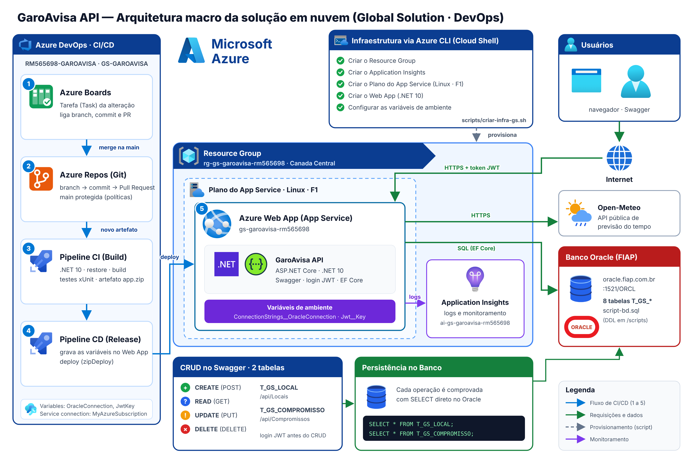

# GaroAvisa — Global Solution 2026/2: DevOps Tools & Cloud Computing

> API de alertas de tempo para a rotina do cidadão (tema **CitizenTech**).
> Aplicação **.NET 10 (ASP.NET Core Web API)** com banco **Oracle em nuvem**,
> entregue por uma esteira de **CI/CD no Azure DevOps** que compila, testa e
> publica automaticamente a API em um **Azure Web App** a cada Pull Request
> aprovado na branch principal.

- **Aplicação no ar (Swagger):** https://gs-garoavisa-rm565698.azurewebsites.net/swagger/index.html
- **Organização no Azure DevOps:** https://dev.azure.com/RM565698-GAROAVISA

---

## Demonstração do CI/CD (vídeo)

> O link do YouTube será incluído aqui após a gravação.

<details>
<summary>O que é mostrado no vídeo</summary>

1. Organização e projeto no Azure DevOps: membros com acesso **Basic**, projeto privado, Scrum, professor como **Project Administrator**, service connection e políticas da branch `main`
2. README: solução proposta, conceito de DevOps e desenho da arquitetura
3. Scripts no repositório (`criar-infra-gs.sh` e `script-bd.sql`) e recursos criados no Portal da Azure
4. Configuração da pipeline: YAML (stages, jobs e tasks) e variáveis
5. Nova tarefa no **Azure Boards**
6. Nova **branch** a partir da tarefa e alteração no código-fonte (`Program.cs`), com commit vinculado à tarefa
7. **Pull Request**, aprovação e **merge** na `main`
8. Início automático da pipeline e explicação de cada etapa nos logs do CI e do CD
9. Artefato publicado e resultados dos testes automatizados
10. Alteração publicada na nuvem
11. CRUD completo em **duas tabelas** (Locais e Compromissos), com `SELECT` no Oracle a cada operação
12. Tarefa concluída no Boards, com os links de branch, commit e Pull Request

</details>

---

## Índice

- [Sobre o Projeto](#sobre-o-projeto)
- [Benefícios para o Cidadão](#benefícios-para-o-cidadão)
- [Descrição da Solução e Stack](#descrição-da-solução-e-stack)
- [Arquitetura + Fluxo CI/CD](#arquitetura--fluxo-cicd)
- [Estrutura do Repositório](#estrutura-do-repositório)
- [Banco de Dados em Nuvem](#banco-de-dados-em-nuvem)
- [Projeto no Azure DevOps](#projeto-no-azure-devops)
- [Políticas da Branch main](#políticas-da-branch-main)
- [Pipeline CI/CD (YAML)](#pipeline-cicd-yaml)
- [Testes Automatizados](#testes-automatizados)
- [Pré-requisitos](#pré-requisitos)
- [Instalação (How-To)](#instalação-how-to)
- [Fluxo de uma Alteração](#fluxo-de-uma-alteração)
- [Testando o CRUD](#testando-o-crud)
- [Segurança](#segurança)
- [Limpeza dos recursos](#limpeza-dos-recursos)
- [Equipe](#equipe)

---

## Sobre o Projeto

Em cidades como São Paulo, chuvas fortes, ventos e mudanças bruscas de
temperatura afetam diretamente a rotina das pessoas: alagamentos no caminho
do trabalho, compromissos ao ar livre perdidos e falta de aviso com
antecedência. A informação sobre o tempo existe, mas não chega ligada ao que
cada pessoa vai fazer e aonde vai.

O **GaroAvisa** resolve isso: o usuário cria uma conta, cadastra os **locais**
que fazem parte do seu dia (Casa, Trabalho, Escola...) e os seus
**compromissos** em cada local. A API consulta a previsão do tempo na
**Open-Meteo** e gera **alertas** quando a previsão atinge as regras de risco
(chuva forte, vento forte, calor, frio e tempestade), além de avisar quando a
previsão muda de forma brusca.

**Nesta entrega**, o foco é a prática de **DevOps**: toda alteração no código
segue o mesmo caminho, rastreável e automático, no **Azure DevOps**:

1. a alteração nasce como uma **tarefa no Azure Boards**;
2. é feita numa **branch** criada a partir da tarefa, com **commit vinculado** a ela;
3. entra na `main` somente por **Pull Request** aprovado (branch protegida por políticas);
4. o merge dispara o **CI**, que compila, executa os **testes automatizados (xUnit)** e publica o **artefato** (`app.zip`);
5. o novo artefato dispara o **CD**, que grava as variáveis de ambiente e faz o **deploy automático** no **Azure Web App**;
6. a tarefa é concluída com todos os links (branch, commits e Pull Request).

---

## Benefícios para o Cidadão

| Benefício | Descrição |
|---|---|
| **Alerta no lugar certo** | Os avisos são gerados para os locais que a pessoa realmente frequenta, e não para a cidade inteira |
| **Planejamento dos compromissos** | Cada compromisso mostra a previsão e os alertas do dia em que vai acontecer |
| **Aviso de mudança brusca** | A API compara a previsão nova com a anterior e avisa quando o tempo muda muito |
| **Regras configuráveis** | Os limites de chuva, vento, calor, frio e tempestade são regras cadastradas, ajustáveis sem mudar o código |
| **Preferências do usuário** | Resumo diário, silêncio noturno e tipos de aviso podem ser ligados ou desligados |
| **Dados públicos e gratuitos** | A previsão vem da Open-Meteo, sem custo de licença |
| **Entrega contínua** | Correções e melhorias chegam à nuvem em minutos, com testes automáticos antes de cada deploy |

---

## Descrição da Solução e Stack

**O que a aplicação faz:** é uma API REST documentada no Swagger. Após o
cadastro e o login (token **JWT**), o usuário gerencia seus **locais** e
**compromissos** (CRUD), consulta a previsão e os alertas de cada local e
ajusta suas preferências. Usuários com perfil **ADMIN** cadastram as regras
de alerta e disparam a verificação dos alertas.

| Camada | Tecnologia |
|---|---|
| Linguagem | C# |
| Framework | .NET 10 — ASP.NET Core Web API (Controllers) |
| Acesso a dados | Entity Framework Core (provider Oracle) |
| Autenticação | JWT (Bearer) |
| Documentação | Swagger (Swashbuckle) |
| Banco de dados | Oracle Database (servidor da FIAP — banco em nuvem) |
| Previsão do tempo | Open-Meteo (API pública) |
| Testes | xUnit + Moq + `WebApplicationFactory` (banco em memória) |
| Repositório | Azure Repos (importado do GitHub) |
| Gestão do trabalho | Azure Boards (Scrum) |
| CI/CD | Azure Pipelines (YAML, multi-stage: CI + CD) |
| Hospedagem | Azure App Service — Web App Linux (.NET 10), plano F1 |
| Monitoramento | Azure Application Insights |
| Provisionamento | Azure CLI (script Bash no Azure Cloud Shell) |

---

## Arquitetura + Fluxo CI/CD



| Passo | Onde atua | O que acontece |
|---|---|---|
| **0** | Azure Cloud Shell | O script `scripts/criar-infra-gs.sh` cria o Resource Group, o Application Insights, o App Service Plan e o Web App, e grava as variáveis de ambiente (executado uma vez, antes da pipeline) |
| **1** | Azure Boards | A alteração é registrada como uma tarefa (Task) |
| **2** | Azure Repos | Uma branch é criada a partir da tarefa; o commit é feito nela, vinculado à tarefa |
| **3** | Azure Repos | O Pull Request passa pelas políticas da `main` (revisor e work item) e é aprovado e mesclado |
| **4** | Azure Pipelines — Stage CI | O merge na `main` dispara a pipeline: .NET 10 restaura, compila e executa os testes xUnit |
| **5** | Azure Pipelines — Stage CI | A API é publicada e compactada no artefato `app` (`app.zip`) |
| **6** | Azure Pipelines — Stage CD | Com o novo artefato, o stage CD inicia e baixa o `app.zip` |
| **7** | Azure Web App | O CD grava as variáveis de ambiente no Web App e faz o deploy (zipDeploy) |
| **8** | Oracle (FIAP) e Open-Meteo | A API grava os dados no Oracle e consulta a previsão na Open-Meteo |
| **9** | Navegador | O usuário acessa a API pelo Swagger, com HTTPS e o token JWT |
| **10** | VS Code + Oracle | Cada operação do CRUD é conferida com `SELECT` direto no banco |
| **11** | Azure Boards | A tarefa é concluída com os links da branch, dos commits e do Pull Request |

---

## Estrutura do Repositório

```
.
├── dotnet-gs2/               → código-fonte da API .NET 10 (GaroAvisa) e testes xUnit
├── imagem/
│   └── arquitetura.png       → desenho macro da arquitetura
├── scripts/
│   ├── criar-infra-gs.sh     → script Azure CLI que cria a infraestrutura
│   └── script-bd.sql         → DDL das 8 tabelas no Oracle
├── azure-pipeline.yml        → pipeline CI/CD (YAML), na raiz
└── README.md
```

A pasta `dotnet-gs2/` é uma cópia do repositório da API .NET da Global
Solution ([GLOBAL2-2026-GaroAvisa/dotnet-gs2](https://github.com/GLOBAL2-2026-GaroAvisa/dotnet-gs2)).
O projeto não utiliza containers, por isso não há pasta `dockerfiles`.

---

## Banco de Dados em Nuvem

- **Banco:** Oracle Database da FIAP — `oracle.fiap.com.br:1521/ORCL`.
- **DDL:** o arquivo [`scripts/script-bd.sql`](scripts/script-bd.sql) cria as
  8 tabelas, com chaves primárias, chaves estrangeiras (`ON DELETE CASCADE`)
  e índices. É o mesmo modelo gerado pelas migrations do EF Core.
- **Conexão:** a API lê a string `ConnectionStrings__OracleConnection` das
  variáveis de ambiente do Web App.

| Tabela | Conteúdo |
|---|---|
| `T_GS_USUARIO` | Contas, com senha em hash e perfil (USUARIO ou ADMIN) |
| `T_GS_LOCAL` | Locais de cada usuário (etiqueta, coordenadas, fuso, principal, receber alertas) |
| `T_GS_PREFERENCIA` | Preferências de notificação de cada usuário |
| `T_GS_REGRA_ALERTA` | Regras que definem quando um alerta é criado |
| `T_GS_ALERTA` | Alertas gerados para cada local |
| `T_GS_PREVISAO` | Última previsão salva de cada local, usada para detectar mudança brusca |
| `T_GS_COMPROMISSO` | Compromissos do usuário em cada local |
| `T_GS_IDEMPOTENCIA` | Respostas guardadas para o controle de idempotência |

---

## Projeto no Azure DevOps

| Campo | Valor |
|---|---|
| **Organization** | RM565698-GAROAVISA |
| **Project name** | GS-GAROAVISA |
| **Description** | Global Solution 2026/2 (CitizenTech) - GaroAvisa API (.NET) - Professor João Carlos Menk + integrantes |
| **Visibility** | Private |
| **Version control** | Git |
| **Work item process** | Scrum |

Integrantes informados na descrição do projeto:

```
RM561713 - Eduardo Batista Locaspi - 2TDSPI
RM563000 - Enzo Vieira Bernardini - 2TDSPI
RM565698 - Liana Lyumi Morisita Fujisima - 2TDSPI
RM561833 - Victor Alves Lopes - 2TDSPI
```

O professor foi convidado com acesso **Basic** na organização e incluído no
grupo **Project Administrators** do projeto.

---

## Políticas da Branch main

Configuradas em **Repos → Branches → main → Branch policies**:

| Política | Configuração |
|---|---|
| **Require a minimum number of reviewers** | Mínimo de 1 revisor, com *Allow requestors to approve their own changes* |
| **Check for linked work items** | *Required*: todo Pull Request precisa estar vinculado a uma tarefa do Boards |
| **Check for comment resolution** | *Required*: todos os comentários precisam estar resolvidos |
| **Automatically included reviewers** | RM565698 incluído automaticamente em todo Pull Request (*Required*) |

Com as políticas ativas, a `main` não aceita commit direto: as alterações
entram somente por Pull Request. Não há *Build Validation*, de modo que o
build é acionado **apenas após o merge** na `main`.

---

## Pipeline CI/CD (YAML)

A pipeline é **YAML multi-stage**. O conteúdo está no arquivo
[`azure-pipeline.yml`](azure-pipeline.yml), na raiz deste repositório.

### Gatilho (CI automático)
```yaml
trigger:
  branches:
    include:
      - main
```
Todo merge na branch `main` dispara a pipeline automaticamente.

### Stage CI — Build e Testes
| Task | O que faz |
|---|---|
| `UseDotNet@2` | Instala o .NET 10 SDK no agente `ubuntu-latest` |
| `DotNetCoreCLI@2` (`restore`) | Restaura os pacotes NuGet |
| `DotNetCoreCLI@2` (`build`) | Compila a API em `Release` |
| `DotNetCoreCLI@2` (`test`) | Executa os testes xUnit e publica os resultados na aba **Tests** |
| `DotNetCoreCLI@2` (`publish`) | Gera os arquivos de publicação da API |
| `ArchiveFiles@2` | Compacta a publicação em `app.zip` |
| `PublishPipelineArtifact@1` | Publica o artefato **`app`** no Azure DevOps |

### Stage CD — Deploy no Azure Web App
| Configuração / Task | O que faz |
|---|---|
| `dependsOn: CI` + `condition: succeeded()` | O CD só roda depois que o CI termina com sucesso e gera um novo artefato |
| `deployment` + `environment` | Registra o deploy no *Environment* `gs-garoavisa-rm565698` |
| `download: current` | Baixa o artefato `app` gerado pelo CI desta execução |
| `AzureAppServiceSettings@1` | Grava no Web App `ASPNETCORE_ENVIRONMENT`, `ConnectionStrings__OracleConnection` e `Jwt__Key` |
| `AzureWebApp@1` (`zipDeploy`) | Faz o deploy do `app.zip` no Web App Linux, com o comando `dotnet GaroAvisa.Api.dll` |

### Variáveis da pipeline
Cadastradas em **Pipelines → Edit → Variables**:

| Nome | Valor |
|---|---|
| `OracleConnection` | `User Id=SEU_RM;Password=SUA_SENHA;Data Source=oracle.fiap.com.br:1521/ORCL;` |
| `JwtKey` | chave de assinatura do token JWT (mínimo de 32 caracteres) |

> Por orientação do professor, as variáveis foram cadastradas **sem** a
> opção *Keep this value secret*.

### Service connection
`MyAzureSubscription` — conexão do tipo **Azure Resource Manager**, com
escopo na assinatura e no Resource Group `rg-gs-garoavisa-rm565698`. É ela
que dá permissão para a pipeline configurar e publicar no Web App.

---

## Testes Automatizados

São **47 testes xUnit**, executados no stage CI e publicados na aba
**Tests** da execução da pipeline. Os testes de integração sobem a API em
memória, com um banco próprio para teste, então o CI não depende do Oracle.

| Projeto / Classe | O que valida |
|---|---|
| `UsuarioServiceTests` | Cadastro com senha em hash, e-mail repetido, login e exclusão de conta |
| `LocalServiceTests` | Etiqueta repetida e regra do local principal |
| `LocaisControllerTests` | Respostas do controller de locais (sucesso e não encontrado) |
| `AlertaServiceTests` | Criação de alertas sem duplicar, preferência desligada e escolha da regra mais grave |
| `AvaliadorClimaTests` | Mudança brusca na previsão e tradução dos códigos do tempo |
| `AuthIntegrationTests` | Cadastro, login, exclusão de conta e `401` sem token |
| `LocaisIntegrationTests` | CRUD de locais e bloqueio de acesso aos dados de outro usuário |
| `AlertasIntegrationTests` | Previsão, verificação de alertas, `403` para usuário comum e idempotência |
| `RateLimitingIntegrationTests` | Limite de requisições (`429`) |

---

## Pré-requisitos

- Conta ativa no **Microsoft Azure** (assinatura de estudante)
- Acesso ao **Azure Cloud Shell**
- Organização no **Azure DevOps** (`https://dev.azure.com/{sua-organizacao}`)
- Usuário e senha do **Oracle da FIAP**
- Ferramenta para consultar o banco (ex.: **VS Code** com a extensão *Oracle SQL Developer*)

---

## Instalação (How-To)

### 1. Clonar este repositório (no Azure Cloud Shell)

Abra o **Cloud Shell** no Portal da Azure (ícone `>_`) no modo **Bash**.

`git clone` — baixa este repositório para o Cloud Shell, trazendo o script de infraestrutura e o YAML da pipeline
```bash
git clone https://github.com/GLOBAL2-2026-GaroAvisa/devops-gs2.git
```

`cd` — entra na pasta de scripts
```bash
cd devops-gs2/scripts
```

### 2. Conferir a assinatura da Azure

`az account show` — exibe a assinatura ativa, para confirmar que os recursos serão criados na assinatura correta
```bash
az account show
```

Caso precise trocar de assinatura:
```bash
az account list -o table
az account set --subscription "nome-da-assinatura-correta"
```

### 3. Revisar as variáveis do script

`nano` — abre o script para informar a senha do Oracle e a chave do JWT
```bash
nano criar-infra-gs.sh
```

| Variável | Valor | Para que serve |
|---|---|---|
| `RESOURCE_GROUP_NAME` | `rg-gs-garoavisa-rm565698` | Grupo que reúne todos os recursos do projeto |
| `WEBAPP_NAME` | `gs-garoavisa-rm565698` | Nome do Web App (vira a URL `https://gs-garoavisa-rm565698.azurewebsites.net`) |
| `APP_SERVICE_PLAN` | `gs-garoavisa-rm565698` | Plano de hospedagem do Web App |
| `LOCATION` | `canadacentral` | Região dos recursos |
| `RUNTIME` | `DOTNETCORE:10.0` | Runtime do Web App (mesma versão do projeto) |
| `APP_INSIGHTS_NAME` | `ai-gs-garoavisa-rm565698` | Application Insights para logs e métricas |
| `USERNAME` / `PASSWORD` | usuário e senha do Oracle da FIAP (substitua `xxxxxx`) | Montam a string de conexão gravada no Web App |
| `JWT_KEY` | chave do JWT (substitua `xxxx...`) | Assinatura dos tokens de login |

Para salvar e sair do `nano`: **Ctrl+O**, **Enter**, **Ctrl+X**.

### 4. Criar a infraestrutura

`chmod +x` — concede permissão de execução ao script
```bash
chmod +x criar-infra-gs.sh
```

`./criar-infra-gs.sh` — executa o script, que:
- registra os providers `Microsoft.Web`, `Microsoft.Insights`, `Microsoft.OperationalInsights` e `Microsoft.ServiceLinker`;
- adiciona a extensão `application-insights` ao Azure CLI;
- cria o **Resource Group** (`az group create`);
- cria o **Application Insights** (`az monitor app-insights component create`);
- cria o **App Service Plan** F1 Linux (`az appservice plan create`);
- cria o **Web App** com .NET 10 (`az webapp create`);
- grava as **App Settings** do Web App: conexão do Application Insights, `ASPNETCORE_ENVIRONMENT`, `ConnectionStrings__OracleConnection` e `Jwt__Key` (`az webapp config appsettings set`);
- reinicia o Web App e o conecta ao Application Insights.
```bash
./criar-infra-gs.sh
```

### 5. Conferir os recursos criados

`az resource list` — lista os recursos do Resource Group
```bash
az resource list --resource-group rg-gs-garoavisa-rm565698 --output table
```

`az webapp config show` — confirma que o Web App está com .NET 10 (deve retornar `"DOTNETCORE|10.0"`)
```bash
az webapp config show --name gs-garoavisa-rm565698 --resource-group rg-gs-garoavisa-rm565698 --query linuxFxVersion
```

> Neste ponto o Web App ainda não tem a aplicação: o código chega pela
> pipeline de CD nos próximos passos.

### 6. Criar as tabelas no Oracle

Conectado ao Oracle da FIAP (VS Code + *Oracle SQL Developer*), execute o
conteúdo de [`scripts/script-bd.sql`](scripts/script-bd.sql) e confira:
```sql
SELECT table_name FROM user_tables WHERE table_name LIKE 'T_GS_%' ORDER BY table_name;
```
O resultado deve listar as **8 tabelas** `T_GS_*`.

### 7. Configurar a organização no Azure DevOps

Em `https://dev.azure.com/{sua-organizacao}`:

1. **Organization settings → Pipelines → Settings**
2. Deixe **desligadas** as opções *Disable creation of classic build
   pipelines* e *Disable creation of classic release pipelines*.

### 8. Criar o projeto e convidar o professor

1. **New project**, com os dados da seção [Projeto no Azure DevOps](#projeto-no-azure-devops)
   (nome, descrição com o professor e os integrantes, *Private*, *Git*, *Scrum*).
2. **Organization settings → Users → Add users:** e-mail do professor,
   **Access level: Basic**, projeto **GS-GAROAVISA**, grupo **Project Administrators**.
3. Confira em **Project settings → Overview → Project administrators**.

### 9. Importar o repositório

1. **Repos → Import a repository → Import**
2. **Clone URL:** `https://github.com/GLOBAL2-2026-GaroAvisa/devops-gs2.git`
3. Clique em **Import** e confira em **Repos → Files** as pastas
   `dotnet-gs2`, `imagem` e `scripts`, o `azure-pipeline.yml` e a branch `main`.

### 10. Criar a Service Connection

1. **Project settings → Pipelines → Service connections → Create service connection**
2. Tipo **Azure Resource Manager** → **Next**
3. Preencha:
   - **Identity type / Credential:** manter o padrão
   - **Scope level:** Subscription
   - **Subscription:** a sua assinatura
   - **Resource group:** `rg-gs-garoavisa-rm565698`
   - **Service Connection Name:** `MyAzureSubscription` (mesmo nome usado no YAML)
   - **Description:** `Credenciais para minha assinatura da Azure`
   - Marque **Grant access permission to all pipelines**
4. **Save**

### 11. Criar a pipeline a partir do YAML

1. **Pipelines → Create Pipeline**
2. **Azure Repos Git (YAML)** → selecione o repositório **GS-GAROAVISA**
3. **Existing Azure Pipelines YAML file** → Branch `main` → Path `/azure-pipeline.yml` → **Continue**
4. **Variables → New variable** e cadastre `OracleConnection` e `JwtKey`
   (ver [Variáveis da pipeline](#variáveis-da-pipeline)) → **Save**

### 12. Executar a pipeline pela primeira vez

1. **Run**
2. O **Stage CI** executa (build, testes e artefato).
3. Na primeira execução, o **Stage CD** pode ficar em *Waiting — Permission
   needed*: clique em **View → Permit → Permit** para autorizar o acesso ao
   Environment e à Service Connection. Isso só é necessário na primeira vez.
4. O **Stage CD** faz o deploy no Web App.

### 13. Proteger a branch main

Em **Repos → Branches → main → ⋮ → Branch policies**, configure as políticas
da seção [Políticas da Branch main](#políticas-da-branch-main). A partir daqui,
toda alteração entra por Pull Request.

### 14. Conferir o resultado da pipeline

- **Summary:** stages CI e CD em verde, *1 published* (artefato) e *100% tests passed*
- **Tests:** 47 testes, 100% aprovados
- **Artefato:** em *Related → 1 published*, o artefato `app` com o `app.zip`
- **Jobs:** cada task do CI e do CD com seu log de execução
- **Environments:** o deploy registrado em `gs-garoavisa-rm565698`

### 15. Acessar a aplicação

Após o deploy, aguarde cerca de 1 minuto (o plano gratuito leva esse tempo
para iniciar a API) e acesse o Swagger:

```
https://gs-garoavisa-rm565698.azurewebsites.net/swagger/index.html
```

---

## Fluxo de uma Alteração

Com a `main` protegida, toda alteração no código segue este caminho:

1. **Boards → Work items → New Work Item → Task:** título, descrição, *Assigned To* e estado *In Progress*.
2. Na tarefa, **Development → Create a branch** (baseada na `main`, já vinculada à tarefa).
3. **Repos → Files**, na branch nova: **Edit** no arquivo do código-fonte → **Commit**, vinculando a tarefa em *Work items to link*.
4. **Create a pull request** da branch para a `main`: o revisor padrão e a tarefa já aparecem vinculados.
5. **Approve** → **Complete** → *Merge (no fast forward)*, com **Complete associated work items after merging** marcado e sem apagar a branch → **Complete merge**.
6. O merge dispara o **CI** e, com o novo artefato, o **CD**.
7. A tarefa fica **Done**, com os links da branch, do commit e do Pull Request em **Development**.

---

## Testando o CRUD

> O CRUD é feito pelo **Swagger** da aplicação na nuvem, em **duas tabelas**:
> `T_GS_LOCAL` (`/api/Locais`) e `T_GS_COMPROMISSO` (`/api/Compromissos`).
> Todas as rotas exigem login, então o primeiro passo é criar a conta e
> informar o token em **Authorize**.
>
> Cada operação é conferida **antes e depois direto no Oracle** (VS Code +
> extensão Oracle SQL Developer), sempre com o mesmo `SELECT` de cada tabela.
>
> **Ordem:** o compromisso depende do local (`localId`), então o local é
> criado primeiro. Na exclusão, o compromisso é apagado antes do local.

**SELECTs usados em todas as etapas**
```sql
SELECT ID, ID_USUARIO, ETIQUETA, NOME, PRINCIPAL, RECEBER_ALERTAS FROM T_GS_LOCAL;
SELECT ID, ID_LOCAL, NOME, DT_COMPROMISSO FROM T_GS_COMPROMISSO;
```

| Etapa | Resultado esperado do SELECT |
|---|---|
| Antes do CREATE | Nenhuma linha nas duas tabelas |
| Depois do CREATE do local | `T_GS_LOCAL`: 1 linha, Casa · Tatuapé |
| Depois do UPDATE do local | `T_GS_LOCAL`: Casa da Liana · RECEBER_ALERTAS = 0 |
| Depois do CREATE do compromisso | `T_GS_COMPROMISSO`: 1 linha, Consulta médica · 22/11/2026 09:00 |
| Depois do UPDATE do compromisso | `T_GS_COMPROMISSO`: Consulta médica (remarcada) · 23/11/2026 15:00 |
| Depois do DELETE do compromisso | `T_GS_COMPROMISSO`: nenhuma linha |
| Depois do DELETE do local | `T_GS_LOCAL`: nenhuma linha |

### Login

**Criar conta** — `POST /api/Auth/cadastro`
```json
{
  "nome": "Liana",
  "email": "liana@garoavisa.com",
  "senha": "123456"
}
```

**Login** — `POST /api/Auth/login`
```json
{
  "email": "liana@garoavisa.com",
  "senha": "123456"
}
```
Copie o `token` da resposta, clique em **Authorize**, cole o token e confirme.

### Tabela T_GS_LOCAL — `/api/Locais`

**CREATE** — `POST /api/Locais` (resposta `201`; anote o `id`)
```json
{
  "etiqueta": "Casa",
  "nome": "Tatuapé",
  "estado": "São Paulo",
  "pais": "Brasil",
  "latitude": -23.53729,
  "longitude": -46.5666,
  "fuso": "America/Sao_Paulo",
  "principal": true,
  "receberAlertas": true
}
```

**READ** — `GET /api/Locais` (lista) e `GET /api/Locais/{id}` (um local), resposta `200`

**UPDATE** — `PUT /api/Locais/{id}` (resposta `200`)
```json
{
  "etiqueta": "Casa da Liana",
  "principal": true,
  "receberAlertas": false
}
```

**DELETE** — `DELETE /api/Locais/{id}` (resposta `204`; apaga também os compromissos do local)

### Tabela T_GS_COMPROMISSO — `/api/Compromissos`

**CREATE** — `POST /api/Compromissos` (resposta `201`; use o `id` do local e uma data futura)
```json
{
  "localId": 1,
  "nome": "Consulta médica",
  "dataHora": "2026-11-22T09:00:00"
}
```

**READ** — `GET /api/Compromissos` (lista) e `GET /api/Compromissos/{id}` (um compromisso), resposta `200`

**UPDATE** — `PUT /api/Compromissos/{id}` (resposta `200`)
```json
{
  "localId": 1,
  "nome": "Consulta médica (remarcada)",
  "dataHora": "2026-11-23T15:00:00"
}
```

**DELETE** — `DELETE /api/Compromissos/{id}` (resposta `204`)

---

## Segurança

- **Autenticação e autorização:** as rotas de dados exigem token **JWT**.
  Cada usuário só acessa os próprios locais, compromissos e alertas; rotas
  administrativas exigem o perfil **ADMIN**.
- **Senhas dos usuários:** armazenadas no banco como **hash**, nunca em texto puro.
- **Rate limiting e idempotência:** a API limita a quantidade de requisições
  por minuto (`429`) e evita registros duplicados com o cabeçalho
  `Idempotency-Key`.
- **HTTPS:** a API é acessada pelo domínio `azurewebsites.net`, com HTTPS
  fornecido pelo Azure App Service.
- **Credenciais fora do código:** a conexão com o Oracle e a chave do JWT
  são lidas de variáveis de ambiente (`ConnectionStrings__OracleConnection`
  e `Jwt__Key`), gravadas no Web App pela pipeline a partir das *Variables*
  do Azure DevOps. No script do repositório, a senha e a chave ficam como
  `xxxxxx`. Por orientação do professor, as variáveis não foram marcadas
  como secretas.
- **Acesso à Azure pela pipeline:** feito pela Service Connection
  `MyAzureSubscription` (Workload Identity Federation), sem senha ou chave
  armazenada no YAML.
- **Branch protegida:** a `main` só recebe alterações por Pull Request
  aprovado e vinculado a uma tarefa do Boards.

---

## Limpeza dos recursos

`az group delete` — remove o Resource Group inteiro (Web App, App Service
Plan e Application Insights), evitando custos após a avaliação
```bash
az group delete --name rg-gs-garoavisa-rm565698 --yes --no-wait
```

`rm -rf` — remove a pasta deste repositório do Cloud Shell
```bash
rm -rf devops-gs2
```

---

## Equipe

| RM | Nome | Turma |
|---|---|---|
| RM561713 | Eduardo Batista Locaspi | 2TDSPI |
| RM563000 | Enzo Vieira Bernardini | 2TDSPI |
| RM565698 | Liana Lyumi Morisita Fujisima | 2TDSPI |
| RM561833 | Victor Alves Lopes | 2TDSPI |
